# Comparing coding agents.

## Summary of findings
* Planning is the most important part, and even if you explain to the agent what you want, you still need to double check the final plan it comes up with
* Don't be afraid to push back and question the agent, all agents tried to roll their own zip code because they were overzealously interpreting the spec. Question them about why they made certain decisions
* Don't just blindly trust their results, or their tests, test yourself
  * the Grok implementation is 12x slower than the others, because it adds a wait in its buffer, neither opus or qwen flash did this
  * Qwen Flash made some odd choices based on incorrect assumptions it made, it made an incorrect assumption about the stdlib zipfile
    * it asserted that it could not stream compressed data due to not being able to seek backwards. This is plain wrong, this resulted in an extra dependency. 
    * this resulted in its design being a bit difficult to follow. Truth be told I primarily looked at Claude's code, for Grok and Qwen I only really skimmed.
* This was fun, I went beyond the brief purely for that reason!

## The brief
This was part of a take home coding exercise, of which the use of AI was explicitly required.
The logic behind this is that such tools are now commonplace and increasingly developers need to be competent with them.
The requirements are outlined in the PDF at the root of this repo.

Broadly it is to do the following:
* build a FastAPI endpoint that accepts files in a single request, zips them up and returns them in the response
* containerise the service via Docker
* create a CI/CD pipeline, GitHub actions is recommended but it is left up to me to decide what and how.

Disclaimer: I included a front end so that it could easily be tested via the browser, but it's not polished. It's just there to conventiently test the microservices via the browser. 

## Repositories
All in the [zip-agents](https://github.com/zip-agents) GitHub organisation, live at https://zip-agents.com.

| Repository | What it is |
|---|---|
| [api-gateway](https://github.com/zip-agents/api-gateway) | this repo: the gateway, the shared AWS platform (Terraform), local compose stack, smoke and performance tests |
| [claude-code](https://github.com/zip-agents/claude-code) | the zip service written by Claude Code (Opus 5.5) |
| [grok-build](https://github.com/zip-agents/grok-build) | the zip service written by Grok Build (4.7) |
| [dsh-qwen-flash-next](https://github.com/zip-agents/dsh-qwen-flash-next) | the zip service written by DeepSeek Harness (DSH) with Qwen 3.8 Flash Next, running locally |

## My initial approach
First thing was to research how FastAPI handles file uploads and the fine details of zipping files.

### Zip files
The structure of a zip file:
```text
[Local header 1][data 1][data descriptor 1]
[Local header 2][data 2][data descriptor 2]
...
[Central directory: one record per entry, with the true sizes, CRCs and offsets]
[End of Central Directory (EOCD): where the central directory starts, entry count]
```
Each entry's header normally needs the CRC sizes up front, but you only know this after compression.
Streaming works around this by writing zeros and then appending a small descriptor of the data.
DEFLATE (compression algorithm) and CRC-32 (chunk hashing algorithm) both work chunk by chunk with constant memory, meaning we don't need the whole file.
We don't know max file size that we may be dealing with, hence we will be using Zip64 (32 bit would mean 4GiB max file size).

### Starlette and hence FastAPI
FastAPI is built on top of Starlette. Starlette is an ASGI (Asynchronous Server Gateway Interface) framework.
A request body arrives as a series of ASGI `http.request` messages, each holding a chunk of bytes which Starlette exposes via `request.stream()`, an async iterator over the raw chunks.
During dependency resolution, before any handlers run, if any of our fields are declared as `Field()` or `Form` Starlette's `MultiPartParser` takes over.
This would happen during parsing, when `await request.form()` is called.
This results in the first 1 MiB being stored in memory and then the rest being spooled(written) to disk *before* our handler executes code. All files would have to be recieved and written to disk *before* we can begin streaming the response. This would mean that the bottleneck would be the disk IO. This would be a performance killer and also introduce limitations, on file size and number of files. If multiple concurrent requests were received at the same time, even if we placed limits on number of files and file size, this could be used to ddos the server and/or severely limit scalability.
It would also mean the time before receiving the first zipped byte would be after all the uploaded files had been written to disk.

We can forgo `File()` from the type annotations, and instead handle the `request: Request` pipeline ourselves.
This has some downsides/consequences:
* the zip filename has to arrive *before* the file parts, meaning curl requests would need the `-F` flag to send parts in the order given. HTML forms would send fields in DOM order, Python `requests` and `httpx` would require `data=` fields before `files`
* not Content-Length in response
* Errors after the first byte cant become 4xx, we already sent 200 by that stage. We would have to abort instead. We need to validate as much as we can up front and document mid stream failure.
* Fragility
  * some proxies buffer one side or the other
  * Starlette's `StreamingResponse` also runs a background `recieve()` loop to detect disconnects, this can compete with body reading. This depends on the Starlette version and the ASGI spec. This will require a test dedicated to detecting this and pinning the version of FastAPI/Starlette being used.
* CPU on event loop, Deflating 64KB chunk will take well under a millisecond, this adds up under load. zlib releases the GIL on large buffers so offloading the compression to a thread will work well.
* No autogenerated docs, we will need to use `openapi_extra` for `/docs` to still describe the endpoint.
* Potential deadlock with some clients
  * client uploads but doesn't also read
  * we stream compressed output back, client's recieve buffer fills, this blocks our `send()`
  * `send()` is now blocked, so we stop calling `receive()`, stalling client upload
  * both sides now wait on each other forever
  * solution is for us to buffer in memory up to a threshold and then fail beyond that.

### Limits
* `MAX_FILES`=500
  * each record approx 50 bytes, one record per entry, plus name (255 bytes), about 30 bytes of zip64 extra field. approx 330 bytes per file, 500 files results in approx 165 KB per request, plus duplicate name set. 
  * keeps it below Starlette's limit of 1000
* `MAX_CONCURRENT_REQUESTS`=32
  * keeps comfortably within CPU limits
* `OUTPUT_BUFFER_MAX_BYTES`=16777216
  * 16 MiB
  * compressed output held in memory while client reading, when full we pause reading input
* `IDLE_TIMEOUT_SECONDS`=30
  * time allowed with no progress in either direction, returns 408 if tripped
* `MAX_REQUEST_DURATION_SECONDS`=900
  * our effective limit on file sizes is determined by request duration and upload speed

### Name and field limits

* **Archive name: 255 bytes (UTF-8), after `.zip` is appended**
  * Matches the common filesystem filename limit (ext4, APFS and NTFS), so the downloaded file can be saved under the name sent.
  * Keeps the `Content-Disposition` header small; percent-encoding can triple its length, and many proxies cap headers at about 8 KB.
  * Over the limit: `422 invalid-archive-name`.

* **Entry names: 255 bytes (UTF-8), truncated, never rejected**
  * Same filesystem reason: longer names would fail on extraction.
  * Truncated rather than rejected, because most file parts arrive after the `200` has been sent; rejecting one would abort the whole archive.
  * Bounds memory, since names are held in the central directory until the archive ends (500 × 255 bytes ≈ 128 KB).

* **`filename` field value: 1024 bytes (raw)**
  * Field values must be buffered whole before validation; without a cap, a client could exhaust memory.
  * Larger than 255 bytes because it applies to the raw value, before trimming, normalisation and appending `.zip`. The 255-byte rule then decides validity.
  * Over the limit: `422 invalid-archive-name`.

## The plan
I want to use 3 different AI to each consume the same spec, and document how much they get right first try and how much I need to intervene.
I also want to deploy all 3 to AWS behind a router of some sort, which will redirect incoming requests, treating each result as a microservice.
This does mean that each will get a reduntant GitHub action, as there will be a separate GitHub action that handles the validation of each and then their respective deployments. I will leave their respective GitHub actions present as this is part of evaluating the AI generation themselves. Perhaps I will have another script that collects them and combines them?

Given the above information and discussion I have had claude generate an initial prompt that each agent will receive, in the name of fairness.
This prompt is stored in `PROMPT.md` and was developed by having a preliminary investigative conversation with claude, exploring any potential issues (the results of which were detailed above)
This prompt was given at the plan stage to give the models a chance to ask any questions before beginning building their respective apps.

The agents:
* claude code (opus 5.5)
* grok build (4.7)
* local DSH with qwen 3.8

Any further questions the agents had were answered by myself as needed

A master docker compose file will be made in the project root. A `make` script will validate unit tests and the GitHub Actions.

An API gateway will sit in front of these services, treating them as microservices routing to their endpoints via prepending them with the service name.
For example `/claude/api/v1/zip`. This will require an api token to use

## How I ran the agents
None of the agents ran directly on my machine. Each worked in its own sandbox, with only its project folder shared, so an agent could read and change its own code and nothing else. How the sandboxes worked changed part way through, because the first setup made the development loop painful.

### At the start: containers that couldn't run containers
* **Claude Code and Grok Build** each ran in their own podman container (`claude-box`, `grok-box`), with GPU access where needed.
* **DSH** (driving the local Qwen model) also ran in a podman container (`dsh-shell`). It was looser than I'd like: it shared the host's network completely (`--network=host`), ran with seccomp disabled, fetched its MCP servers from npm on every start (`npx -y`, no version pinning), kept its state inside the project folder (which broke on drives without symlink support), and kept DeepSeek's defaults, including its search provider.

The problem was that none of them could run Docker inside their container, and the brief is about containers: building the image, running the smoke test against it, testing CI locally. So every time an agent wanted to check its work, it gave me a command, I ran it on the host, and I pasted the output back. That loop was slow, broke the agent's flow, and made me the bottleneck. DSH made it worse by trying to install binaries in its container to run the tests itself.

### Part way through: a VM per project for DSH
For DSH I replaced the container with a full virtual machine per project (`dsh-vm`):

* Each project gets its own Lima/QEMU VM, cloned from a base VM with the tooling preinstalled (DSH, MCP servers, Python, Node, Docker), so a new project starts quickly and downloads nothing at session start.
* **The VM has its own Docker engine**, so the agent builds and runs containers itself without touching the host. This is what removed the copy-and-paste loop.
* The project folder is the only thing shared from the host, mounted at `/workspace`. Home directories, the SSH agent and other projects aren't visible. Credentials live on the VM's own disk, not in the shared folder.
* The models on the host are reachable from the VM as `host.containers.internal:<port>`.
* DSH's plugin sets are built once as named profiles and copied whole into each project, so a project never fetches plugins itself. For projects on network drives (e.g. sshfs), `--local-state` keeps DSH's own state on local disk and mounts it into the VM separately, so the project drive holds only code.
* DSH's configuration: the local Qwen model is the provider, with thinking switchable per conversation; web search uses keyless DuckDuckGo; DeepSeek's own search (which sends queries to DeepSeek's servers) and DeepSeek session logging are disabled.

The split follows trust: Claude Code and Grok Build stay in podman containers; an unaudited agent gets a VM, which is a much stronger boundary than a container that shares the host's kernel.

### Serving the model
Qwen 3.8 Flash Next runs on the host on vLLM across the 4× RTX 3090s: built from a pinned vLLM commit (`8a728663`) for the 3090s, prefix caching on, launched with Docker, and serving an OpenAI-compatible API on localhost (port 8091 for the tuned lane, 8090 for the standard one). An older oobabooga server is still available on port 5000.

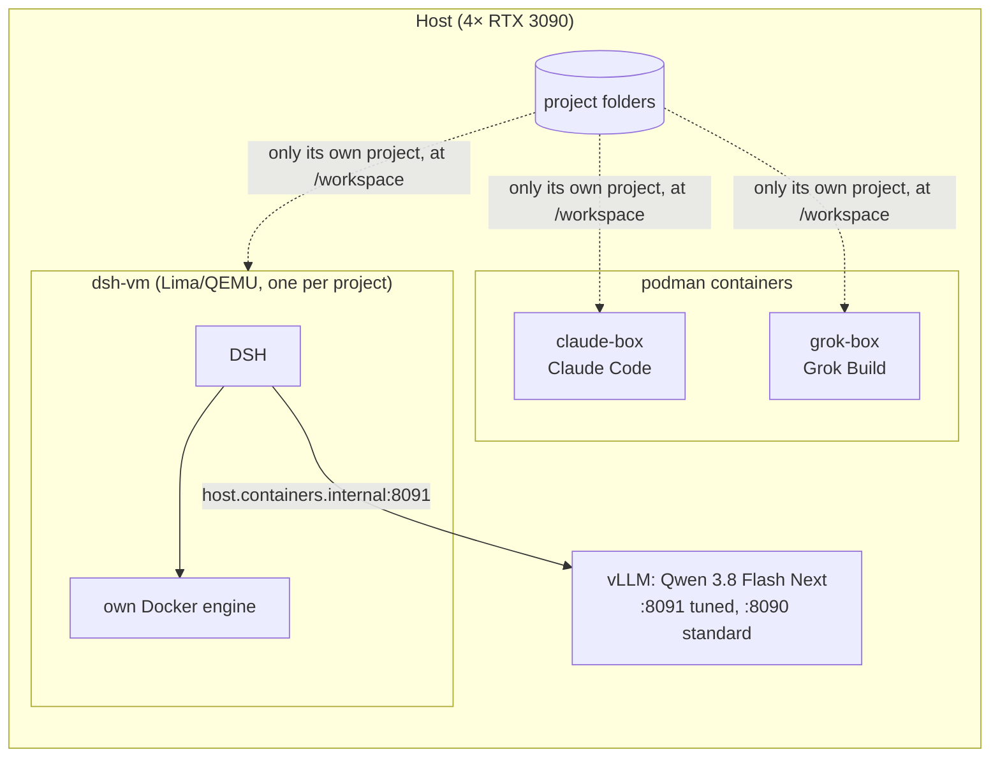

## Working notes while executing
Dear reader, please don't expect the following sections to be structured too much. They are my thoughts while implementing the project. More for myself.
Skip to the next section for a more formal writeup after the work has been finished.

### Claude
claude wanted confirmation that it couldn't spin up the docker container given that it was running in a podman container. this was confirmed, and I mentioned I would run the commands for it.
planning was fast, once plan was confirmed it began working.
Decided to make it also work as an importable package with `__main__.py` as an entrypoint. It also did not break it down into sub modules. I told it to refactor. I wanted better structure and organisation. once pointed in this direction it went in a more sensible direction.

claude created its own zip library rather than use a library, it did so due to an overzealous interpretation of the contract, where we specified 64 bit zips
I had to push back and tell it to switch to the standard zipfile library
Once that was all done, the tests all passed (ran via makefile) and I was happy with the structure. I had to tell it to explicitly add a test that confirmed that we were doing fully streamed compression.

looking at the tests those are well structured (unit, integration and smoke).
asked it to add integration test to explicitly confirm that we were fully streaming
asked it to add test coverage to CI and makefile
told it to add coverage, scored 97%, better than grok


### Grok
did not ask any questions. 
planning took longer
grok did some fancy stuff to be able to run things inside is environment. I should have been clearer about it being in a podman environment and I really need to set it up so it can spin up containers and such inside there or something similar.
grok initially did the same thing as claude, a flat directory, trying to treat it as a cli tool, rolling its own zip library. had to correct this.
after telling it that we don't want a cli tool, it still kept some of the code around. 
told it to add test coverage, grok scored 89%, slightly worse than claude, but acceptable


### local DSH and Qwen 3.8
planning took alot longer, others were done faster
had to interupt it regarding its environment. it did do some work arounds and had more capabilities to run commands
same issues rolling its own zip library, had to intervene. The root cause of why this happens in all three is a fault that lies between the screen and chair.
this one is slow by comparison to the others. Takes much longer. Once I have a better reasoning harness I'm switing to qwen flash for its stupidly greater performance.

ok, this is taking way to long. the other finished literally yesterday, qwen 3.8 is way too slow. slight change of plan is to setup 3.8 next flash via https://github.com/tonyd2wild/Qwen38-Flash-Next-4x3090/tree/main/vllm-w4a16
This has literally become the time sink of the project. grok and claude were finished in about 90 min, this is literally taking days. Once I have setup flash, I will see how far it can get in a day. will abandon it after that.

I got flash working, abandoned original qwen stuff, started again with flash.

The following gif summarises how I felt both at the slowness of Qwen 3.8 and the time sink that was getting Flash to a working state:

<p align="center">
  
</p>


### The Qwen flash rabbit hole
Given the slow speeds of Qwen 3.8, I decided to switch to the new next flash version. Its a more powerful model and its much faster.
I found a repo that optimised it for the architecure I am running locally (4x Nvidia RTX 3090) but it had a bug where it pinned a nightly vLLM image which no longer existed. I got claude to fix that and I have submitted a pr (https://github.com/tonyd2wild/Qwen38-Flash-Next-4x3090/pull/2)

I also wound up refactoring my entire agentic dev containers. It was getting to be a pain them not being able to run docker and having to copy/paste their test commands and the results back to them. For DSH I forewent podman instead using a full VM (QEMU and KVM for the internal containerisation) I now need to reinstall all my plugins and get it setup once again. This has made agentic development much smoother.

I also decided to task Fable with planning some performance improvements for the qwen flash next runner, to reduce ttft and ideally improve the tokens/s.
For info, I left Qwen 3.8 overnight and it did finish some parts, but took hours. Tokens/s were approx 18-23, next flash is benchmarking at something like 190.

In practice once running I achieved ~125 tokens/s I will push the changes I made and link later, that deserves a whole writeup itself.


### The API gateway
I have tasked claude with coming up with a front end API gateway that all the services can live behind, and I got the agents to generate openapi documentation for their respective microservices. The gateway has to do some modifications when serving the docs such that the urls are `<microservice-name>/api/v1/zip`. It seems to work well. I am also going to add an authentication layer

### general
I was not explicit enough that models should give me commands to run, DSH tried to install binaries and such to run tests locally. Long term I need to give it some ability to work with docker images, same with the others. Just for convenience.

told all of them to write makefiles for running unit tests for me

Claude finished planning first, then grok, then much later DSH (expected as locally running, but no usage limits!)
all tried to make it dual use as a cli tool, my stupid fault. this resulted in initial flat directory structure which was less readable and poorly organised
all tried rolling their own zip functionality. The prompt should have explained why we wanted 64 bit, not for the sake of it but for files greater than 4 GiB.

<p align="center">
  
</p>


## What I had to correct, and changing the process for DSH

### The same two corrections, in all three
Every agent needed the same two pushbacks, DSH included, even though it had a written plan:

1. **Structure.** All three started flat: modules side by side at the top level, and packaged as a CLI tool as well as an API. I had to tell each of them to restructure into submodules by responsibility (API, archive, server or pipeline). Visible in the histories: claude's `2c5068e` "Restructure as an API: main.py entrypoint, packages by responsibility" and grok's `5c4146d` "Lay the API out as a service instead of an installable package". Even after being told, grok kept CLI leftovers (`__main__.py`).
2. **Rolling their own zip stack.** All three set out to write their own ZIP writer instead of using a library. claude (`02b57c1` "Add streaming Zip64 writer", then `890b6df` "Replace the custom Zip64 writer with stdlib zipfile") and grok (`6099862`, then `9729a01` "... write archives with zipfile") moved to the standard library's `zipfile` once told. DSH moved to a library, but **the wrong one**: it chose `zipstream-ng` because "`ZipFile.open(name, "w")` is STORED-only on 3.12". That is false; I checked, and `zipfile` streams DEFLATE to an output that can't seek. The mistake cost an LGPL dependency, and a hack that replaces the library's `time` module with a per-thread proxy just to set the entries' timestamps, which `zipfile` does with one field.

The cause of both is the prompt, not the models. It said "every entry MUST be written with Zip64 extensions" without saying why (files over 4 GiB). Read literally, the standard library doesn't do that: it puts Zip64 in the local header only. So writing their own was a reasonable reading of what I wrote. DSH's prompt even said "you may write it yourself (it isn't large)". The flat CLI layout came from similar ambiguity about what was being built. The lesson: **give the intent behind a requirement, not just the requirement.**

### DSH: a plan first, then a journal
For claude and grok I used each tool's plan mode: I reviewed the plan, then they built (both kept a `PLAN.md`). For DSH I changed the process to give the agent more structure: a long-running local model has to stay on track over many hours and pick up again after interruptions. The prompt made the agent:

* **write `PLAN.md` and commit it before any code**: goal and success criteria, environment facts it had verified, the repository layout, library decisions with reasons, the architecture of one request, assumptions where the contract is silent, the order of work with the riskiest parts first, and the verification commands
* **keep a journal as it goes**, not at the end: `journal/INDEX.md` with one row per task and its status, and one file per task (`journal/01-project-skeleton.md` ... `13-documentation-conformance.md`) with what it did, the decisions and why, and the checks it ran with their results
* **update the plan when it changes**, and say why in the journal

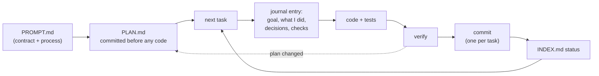

**What worked**
* The history reads like the plan: 13 tasks, one commit each, in order (`b85df5f` "add PLAN.md and journal skeleton before any code", then the skeleton, config, ...).
* Risks first: task 3 was a spike proving full-duplex streaming on real uvicorn before anything was built on it.
* Assumptions written down where the contract is silent, so they can be reviewed rather than discovered.
* I could review it one task at a time, and when I found something odd, the journal told me *why* it had been done. That is how I found the false `zipfile` claim: it was written in the plan and in `journal/04-zip-adapter.md` as a verified fact.

**What it didn't fix**
* A plan doesn't make a claim true. The `zipfile` claim was stated confidently in the plan, then built on for the rest of the project. The journal made the mistake easy to find, not less likely.
* Drift: the plan's layout lists modules that were never written (`lifecycle.py`, `problems.py`, `pipeline/state.py`, ...), the logic went elsewhere, and neither the plan nor the journal says so. Docstrings still refer to `pipeline/state.py`.
* It still started flat and still tried to roll its own zip writer (above). The structure has to be in the prompt; the process alone doesn't supply it.

Overall DSH had the most disciplined process and the most reviewable output of the three, and its speed ended up close to claude's. I'd use the plan-and-journal approach again for any long-running or local agent, and I'd add one thing: a step that checks each "verified" claim in the plan, by a test or by me.

### grok is slower, and only manual testing caught it
All three pass the same contract tests and smoke tests. grok is still about **12× slower** than claude on a large file, and takes **38 s for 500 small files** where claude takes 0.1 s. I only noticed when I used the portal in a browser and grok's zips were obviously slower. I then wrote `make perf` (`perf/bench.py`) to measure it:

| | claude | grok | dsh |
|---|---|---|---|
| 1 × 100 MiB random | 36.8 MiB/s | 3.0 MiB/s | about 37 MiB/s |
| 1 × 100 MiB zeros | 186 MiB/s | 3.3 MiB/s | 84 MiB/s |
| 500 × 4 KiB files | 0.10 s | 37.7 s | 0.14 s |
| time to first byte | 10–30 ms | 10 ms | under 10 ms |

**Why.** grok parses on the event loop and compresses on a separate thread, connected by a queue of only four 64 KiB chunks. When the queue is full, the event loop doesn't wait for room: it sleeps a fixed 100 ms and tries again (`_enqueue` in `api/endpoint.py`). The thread compresses the 256 KiB in a few milliseconds and then sits idle for the rest of the 100 ms. So throughput is capped at about 256 KiB per 100 ms, roughly 2.5 MiB/s, whatever the CPU or network (see the diagram in the Grok section). Zeros are no faster than random data, which shows the cap is the queue, not the compression. Each file is three queue items (start, data, end), so small files hit the same sleep: about 75 ms per file, against 75.5 ms measured. Four parallel uploads get 4 × 3 MiB/s, so the cap is per request, not CPU.

The fix is small: wait for room instead of sleeping, for example by having the thread set an asyncio event (`call_soon_threadsafe`) when it takes an item, or by awaiting `asyncio.to_thread(queue.put, item)`. A bigger queue would only raise the cap. I kept it as a documented result rather than fixing it, since the point is to compare the agents.

**Why the tests missed it.** Nothing in the contract or the tests mentions throughput. The tests check that archives are correct and that streaming starts early (time to first byte), and grok passes both. A 10–30× difference was invisible until a person used it. Performance needs its own check: with more time I would add a throughput floor to the smoke tests (for example, 200 MiB within a set time), so a regression like this fails CI.

## The contract
All three services implement the same contract ([gateway/docs/contract.md](gateway/docs/contract.md), assembled from `PROMPT.md`), so the gateway can treat them as interchangeable. Summarised as one request:

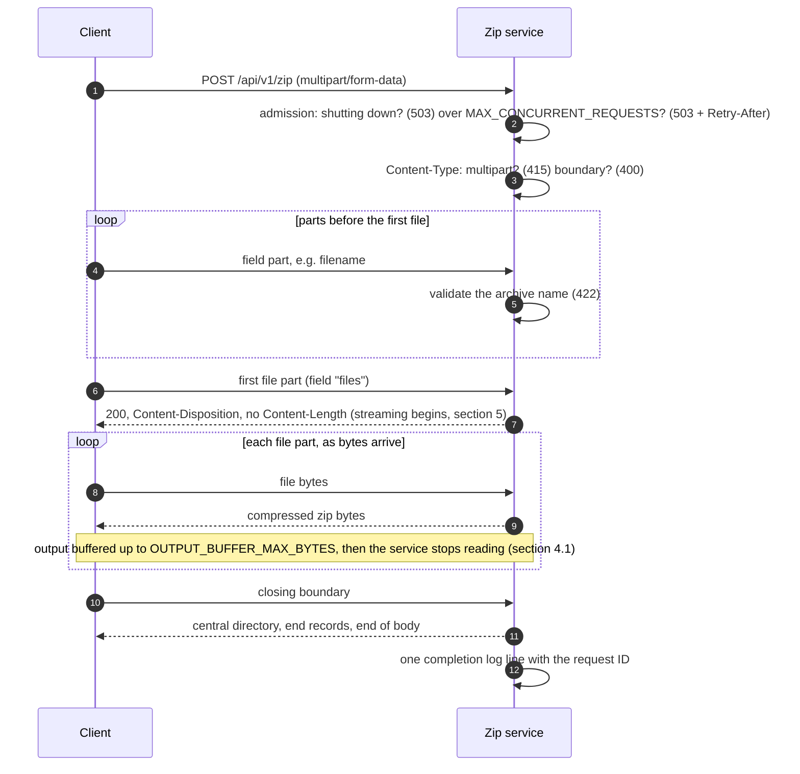

Errors before streaming begins are RFC 9457 `problem+json` responses. After the `200`, the status can't change, so any failure truncates the archive and closes the connection (section 6.2):

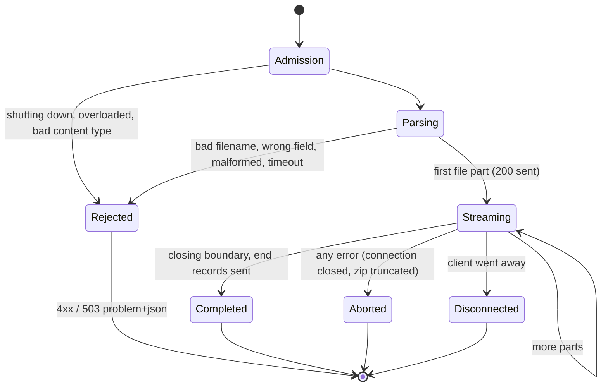

Plus health endpoints (`/health/live`, `/health/ready`), graceful shutdown on SIGTERM within `SHUTDOWN_GRACE_SECONDS`, JSON logs, request IDs, and the documentation endpoints the gateway uses to show each service's docs.

## The API gateway
Everything public goes through the gateway ([api-gateway/gateway](gateway/README.md)), written with Claude Code. The services only ever see requests the gateway has already authenticated; they are not reachable from the internet.

* routes `/<service>/...` to that service over Cloud Map (`claude.zip.internal`), streaming both ways without buffering
* authenticates API calls: operator keys (Secrets Manager) or users' own keys (stored hashed in Aurora)
* per-user quotas on the API, rate limits on the portal's sign-in and invite forms, request IDs, one access log line per request
* the portal: Cognito sign-in, invite codes, API keys, an admin area, the services' docs and OpenAPI under one site
* browser zipping: browsers send the whole upload before reading the response, which the contract's output buffer limits, so the gateway splits a browser zip into an upload and a download request and joins them into one full-duplex exchange with the service

### API request
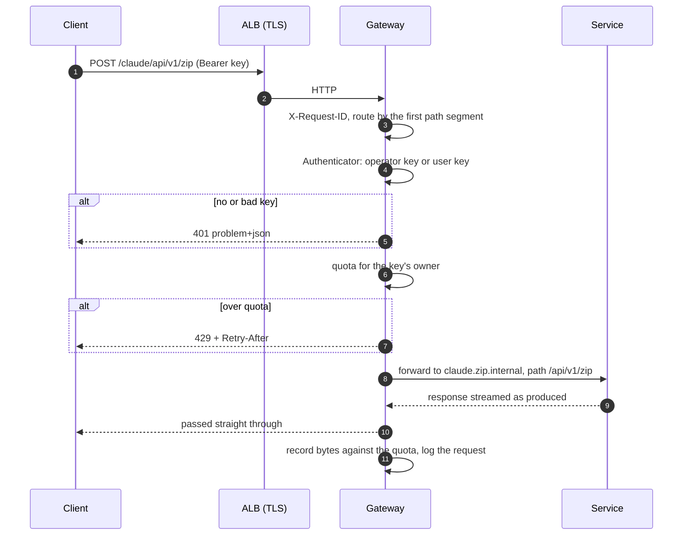

### Browser zip (a job)
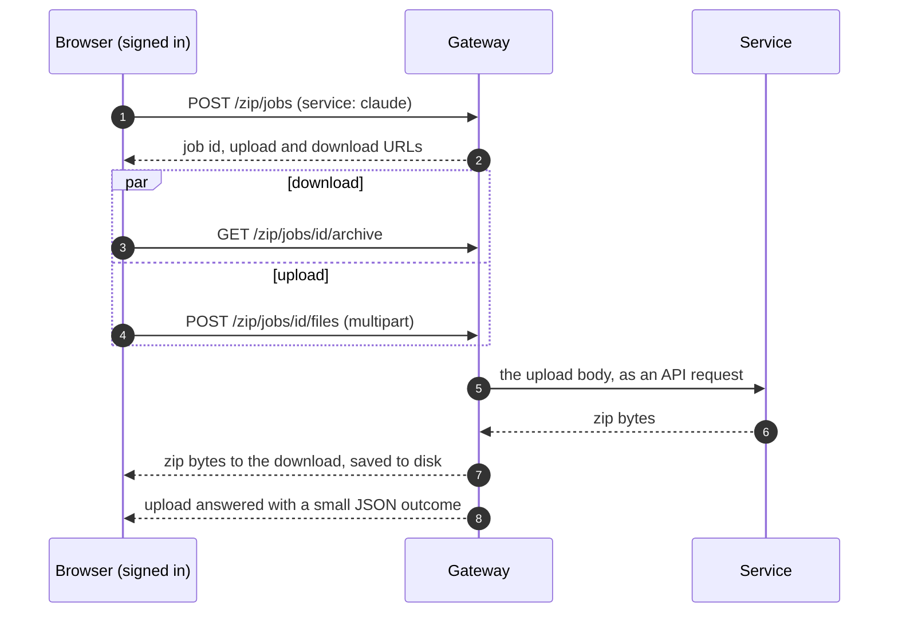

### Signing in
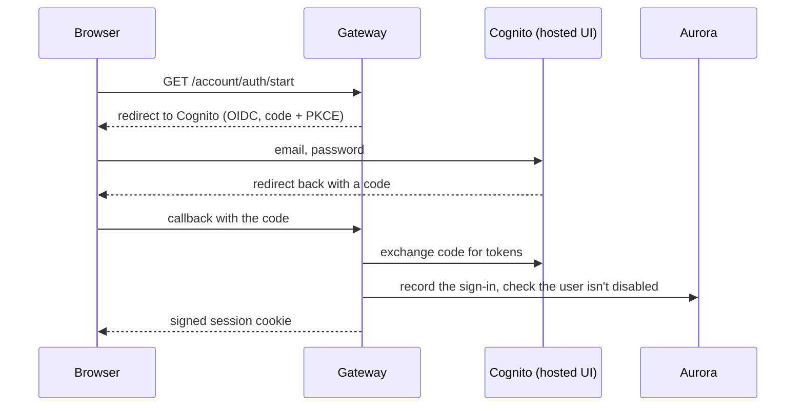

Accounts are created only at `/account/join`, with a one-time invite code from an admin; no email is ever sent.

## Claude generation
**How deeply I reviewed each service.** I went through claude's code in depth; the notes below are from that read. For grok and DSH I skimmed the code and relied on the shared contract tests, smoke tests, `make perf` and targeted reads where something looked off (that is how grok's 100 ms sleep and DSH's false `zipfile` claim turned up). The exception is deployment: the Dockerfiles, CI workflows, deploy workflows and Terraform of all three I reviewed in full, since they run in my AWS account with my credentials.

* final structure good, submodules, sensible separation
* `v1/zip.py` makes sense. `zip_router` written as an app factory pattern.
  * takes raw file, no spooling to disk
  * sensible sanitisation of file names
* `streaming.py` 
  * `ZipPipeline`, heart of the api
    * appropriately uses threading to read, write and watch (enforcing idle duration and limits) the stream
      * threading used because 
  * `OutputBuffer` is what it says on the tin, stores chunks of incoming stream while it compresses and sends them back to the client 

Repository: [zip-agents/claude-code](https://github.com/zip-agents/claude-code). Test coverage: **97%** (unit and integration suites together).

### Tests
121 tests, in two suites. I didn't ask for integration tests; **claude wrote that suite on its own** (`471900c` "Add integration tests against a real server process"). The one test I asked for later was an explicit end-to-end check that compression is fully streamed (`038b4c5`).

* **Unit tests** (`tests/unit/`, mirroring the package: `api/`, `archive/`, `server/`) are clean and I like them. They are small, one behaviour per test, named after the rule they check (`test_streaming_starts_at_first_file_part`, `test_every_entry_reserves_64_bit_sizes`, `test_skipped_parts_do_not_count_towards_max_files`). Because `ArchiveProcessor` does no I/O, most of them drive it directly with bytes, and the contract example is parametrised over chunk sizes of 1, 7 and 4096 bytes and the whole body at once, so multipart boundaries split anywhere are covered. A small shared helper (`tests/multipart_builder.py`) builds request bodies, so tests read as the parts they send.
* **Integration tests** (`tests/integration/`) start the real server in a subprocess and test what unit tests can't: half- and full-duplex clients, archive bytes arriving before the upload finishes, idle timeouts and stalled clients, mid-stream aborts truncating the archive, client disconnects releasing resources, the concurrency limit, health staying responsive under heavy compression, graceful shutdown, memory staying bounded and nothing written to disk during a large upload, and every archive checked with `zipfile`, `unzip -t` and `7z t`. Every server's stdout is checked to be JSON lines when the test ends.

### Structure
```text
zip_service/
├── app.py                 create_app(): routers, error handlers, middleware
├── config.py              Settings (limits, from the environment)
├── api/
│   ├── v1/zip.py          POST /api/v1/zip: admission, then ZipPipeline
│   ├── streaming.py       ZipPipeline: read / write / watchdog tasks, OutputBuffer
│   ├── middleware.py      request IDs, access log (plain ASGI, doesn't buffer)
│   ├── problems.py        RFC 9457 error responses
│   ├── openapi.py docs.py hand-written schema, served docs
│   └── health.py
├── archive/
│   ├── processor.py       ArchiveProcessor: multipart in, zip out (stdlib zipfile)
│   ├── multipart.py       Content-Type / Content-Disposition parsing
│   └── naming.py          255-byte rules, sanitising, de-duplication
└── server/
    ├── server.py          uvicorn subclass: graceful SIGTERM drain
    ├── lifecycle.py       InflightTracker: concurrency cap, shutdown
    ├── context.py         per-request stats (contextvars)
    └── logging.py         JSON logs
```

### Request lifecycle
How claude implements the [contract's lifecycle](#the-contract), from the request reaching the service:
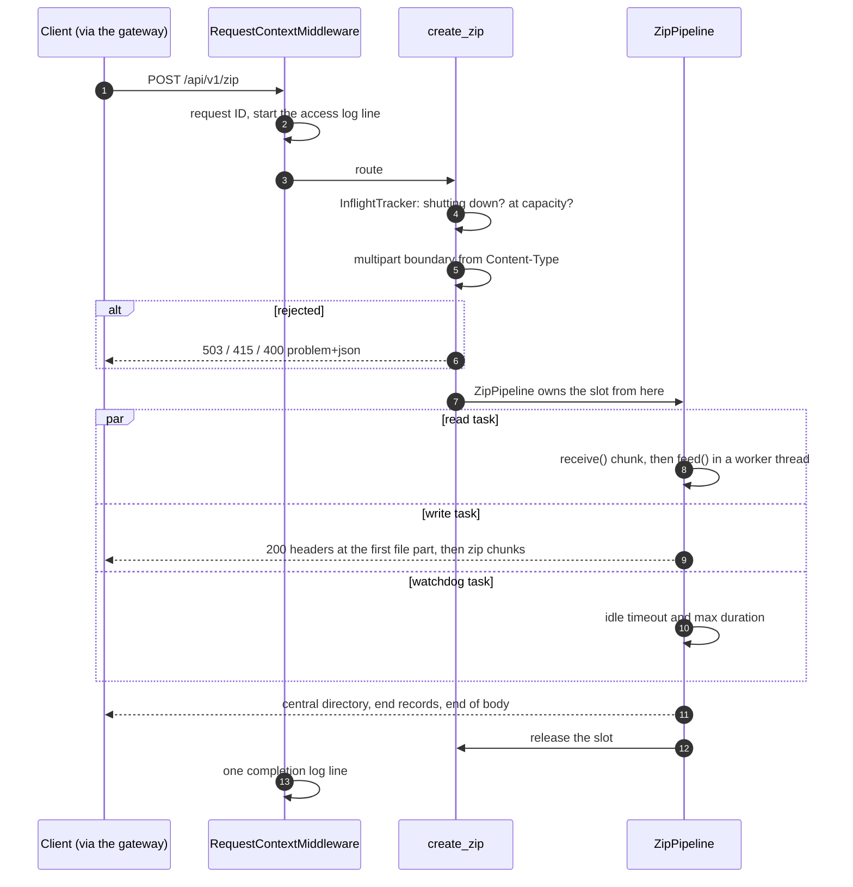

The three are asyncio tasks on the event loop, not threads; only `feed()` (parsing and compression) runs in a worker thread, through `asyncio.to_thread`. `_guard` turns whichever task fails first into the request's single outcome.

### Zipping method
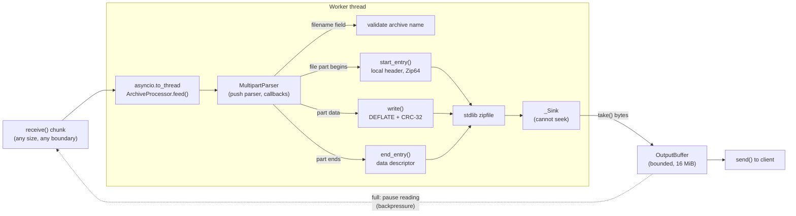

The archive that comes out:
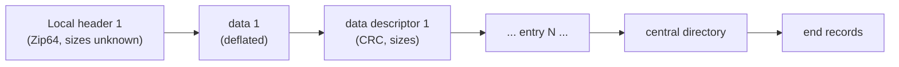

### CI and deployment
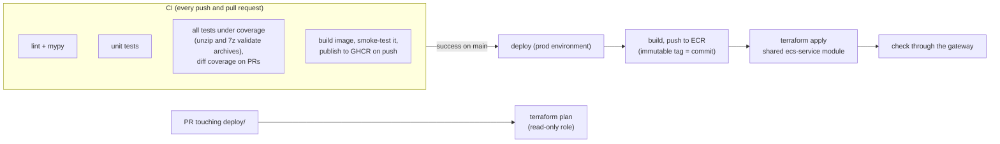

Image: multi-stage on a pinned Python base with uv, runs as UID 10001, `python main.py` (a uvicorn subclass that drains on SIGTERM). Runs on Fargate Spot, 0.25 vCPU and 1 GiB; the memory budget is `MAX_CONCURRENT_REQUESTS` × `OUTPUT_BUFFER_MAX_BYTES` plus headroom.

## Grok generation
Repository: [zip-agents/grok-build](https://github.com/zip-agents/grok-build). Test coverage: **89%**.

* the same contract and tests pass, but it is about 12× slower than claude on large files and takes 38 s for 500 small files. The cause is one line: when its 4-slot queue to the zip thread is full, the event loop sleeps 100 ms instead of waiting for room.
* wrote its own multipart parser (`api/multipart.py`, 535 lines) even though `python-multipart` comes with FastAPI. The same habit as the zip library, but this time I didn't redirect it.
* parsing runs on the event loop; one zip thread per request does the compression.

### Structure
```text
zip_service/
├── __main__.py        entrypoint (leftover of the CLI phase)
├── app.py             create_app(): health, docs, error handlers, request IDs
├── config.py          Settings
├── documents.py       docs catalogue
├── api/
│   ├── endpoint.py    ZipEndpoint: admission, parse loop, _enqueue, writer task
│   ├── multipart.py   hand-written multipart decoder (sync core + async wrapper)
│   ├── gate.py        in-flight counter, graceful shutdown
│   ├── openapi.py
│   └── problems.py    RFC 9457 errors
├── archive/
│   ├── zipstream.py   StreamingZip + ZipWorker thread
│   ├── names.py       archive and entry name rules
│   └── disposition.py Content-Disposition header
└── runtime/
    ├── buffer.py      thread-safe bounded OutputBuffer
    ├── constants.py   queue size, chunk size, limits
    └── jsonlog.py
```

### Request lifecycle
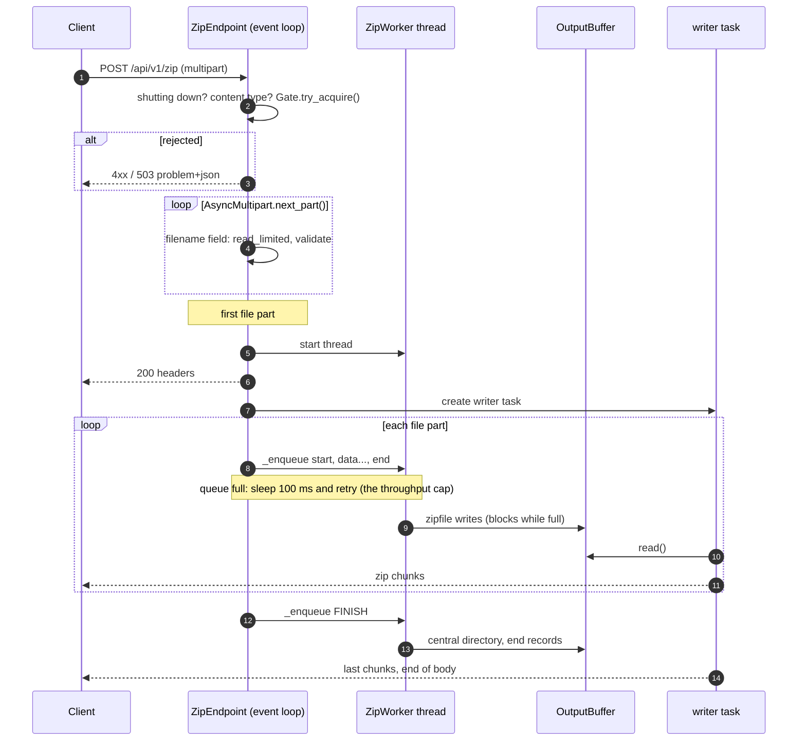

### Zipping method
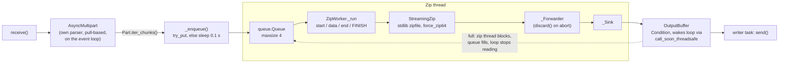

On an abort, `StreamingZip.abandon()` switches the forwarder to discard and then closes the `ZipFile`, so the end records are never sent (claude solves the same problem with a no-op `__del__`).

The throughput cap:
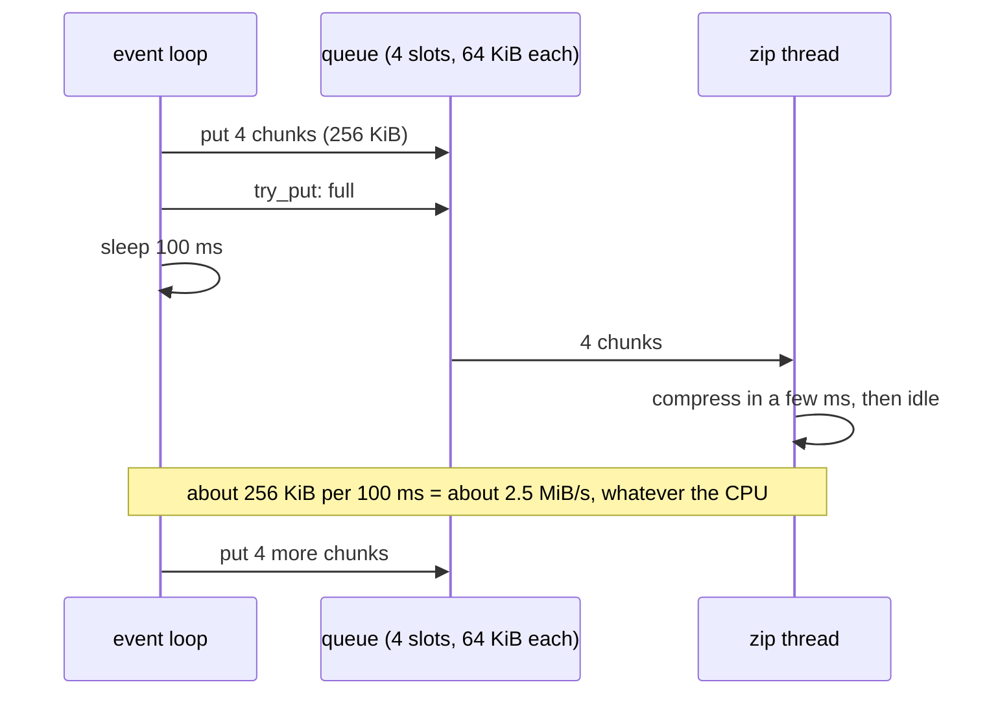

### CI and deployment
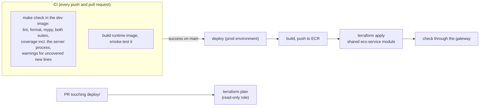

Everything in CI runs inside its dev image through `make`, so a local run and CI are the same. Image: multi-stage on a digest-pinned `python:3.12-slim-bookworm`, non-root user `zip`, `python -m zip_service`. Same Fargate Spot sizing as claude.

## DSH (Qwen 3.8 Flash Next) generation
Repository: [zip-agents/dsh-qwen-flash-next](https://github.com/zip-agents/dsh-qwen-flash-next). Test coverage: **93%** (it had no coverage; I added `make coverage` and a CI step afterwards).

* the most disciplined process: `PLAN.md` first, a journal entry per step (`journal/01-13`), assumptions written down, and full streaming proven before building on it.
* close to claude's speed.
* used `zipstream-ng` instead of stdlib `zipfile`, for a reason that is false ("`ZipFile.open(name, "w")` is STORED-only on 3.12"). That cost an LGPL dependency and a hack that replaces the library's `time` module with a per-thread proxy just to set entry timestamps.
* the flow is inverted: the zip library *pulls* entry data, pulling drives the parser, and the parser pulls from the queue. It works, but it is the hardest of the three to follow.
* a possible freeze: the event loop makes blocking `queue.put()` calls in two places. I couldn't trigger it, but it's more likely at 0.25 vCPU.

### The cost: getting Qwen 3.8 Flash Next running
Getting the model running at all was by far the biggest time sink of the project: **a day and a half**, against about 90 minutes each for claude and grok to build their whole service.

* Qwen 3.8 itself ran at about 18–23 tokens/s on my machine (4× RTX 3090). Left overnight it finished some steps, but at that rate the service would have taken days.
* So I switched to Qwen 3.8 Flash Next, served by vLLM with W4A16 weights, using a setup tuned for exactly this hardware: [tonyd2wild/Qwen38-Flash-Next-4x3090](https://github.com/tonyd2wild/Qwen38-Flash-Next-4x3090/tree/main/vllm-w4a16). It didn't start: it pinned a nightly vLLM image that had been deleted from Docker Hub. My fork, [xgenadam/Qwen38-Flash-Next-4x3090](https://github.com/xgenadam/Qwen38-Flash-Next-4x3090), has the work, sent upstream as two pull requests:
  * [PR #2](https://github.com/tonyd2wild/Qwen38-Flash-Next-4x3090/pull/2), **getting it running**: rebuilds the image from the same vLLM commit's published wheel (checksum-verified, every dependency pinned) so it reproduces the tuned setup exactly; makes the launcher portable (no hard-coded home paths, podman as well as Docker) and verifies at start that its patches are the files actually loaded; and adds a prefix-caching variant.
  * [PR #3](https://github.com/tonyd2wild/Qwen38-Flash-Next-4x3090/pull/3), **improving it**: performance work on the runner, to cut time to first token and raise tokens/s.

<p align="center">
  
</p>
* I also rebuilt my agent sandbox along the way: DSH runs in a full VM (QEMU/KVM) instead of podman, so it can run containers itself rather than me copying commands and results back and forth.

Once it ran, the performance was beautiful: about **125 tokens/s** in practice (benchmarks around 190), five to six times Qwen 3.8, on hardware under my desk, with no usage limits and nothing leaving the machine. From the commit of `PLAN.md` to the final README took about **an hour and a half** (18:23 to 19:58), the same as claude and grok. Worth it for the experience, but a local model is not a quick option to set up: budget for the infrastructure, not just the model.

### Structure
```text
src/zip_service/
├── app.py              app factory, health, shutdown (self-SIGINT, os._exit)
├── config.py
├── api/
│   ├── zip_endpoint.py raw ASGI endpoint: gate, feeder, worker thread, phases
│   ├── docs.py         docs and OpenAPI
│   └── problem.py
├── pipeline/
│   ├── source.py       feeder (loop) + ASGIByteSource (worker), timeouts
│   ├── request.py      ZipRequestHandler: multipart callbacks, start/run
│   ├── multipart.py    Content-Disposition parsing
│   └── output.py       OutputChannel: bounded deque, drain task
├── archive/
│   ├── streaming.py    ArchiveStream over zipstream-ng, time-module pin
│   └── names.py
└── observability/      JSON logs, request-ID middleware
```
Also `journal/` (one file per plan step), and `docs/README.md` and `docs/AGENTS.md`, kept in `docs/` so the image can serve them.

### Request lifecycle
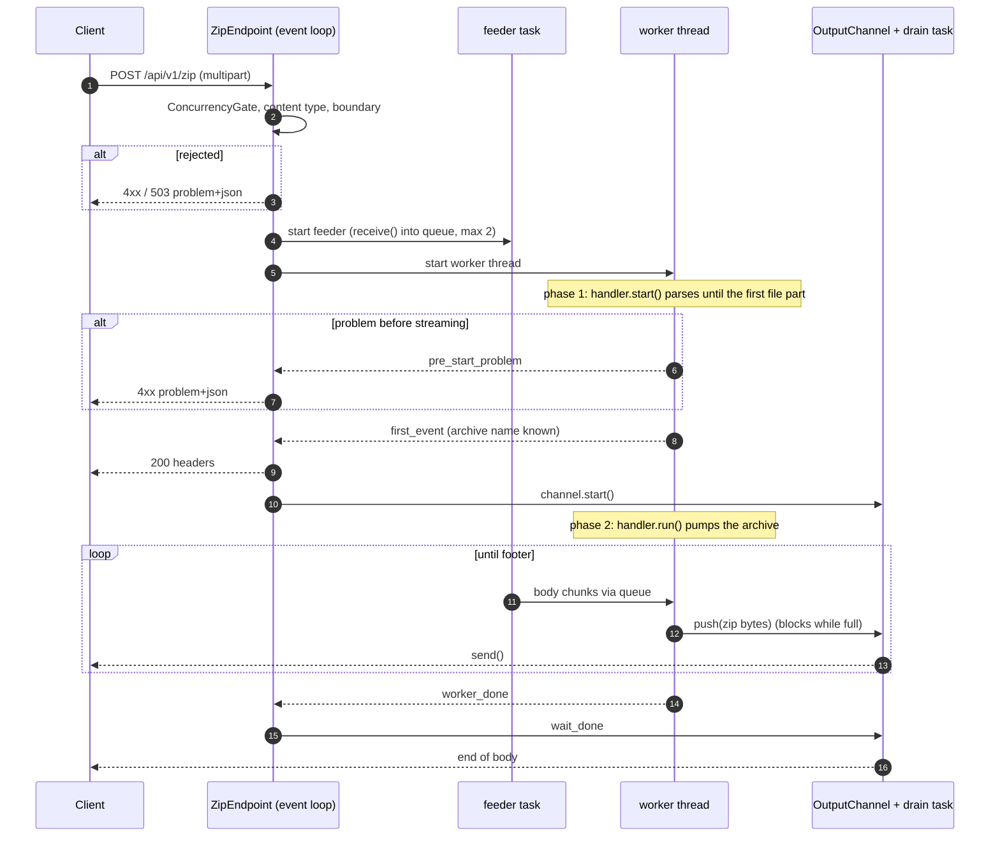

### Zipping method (pull-driven)
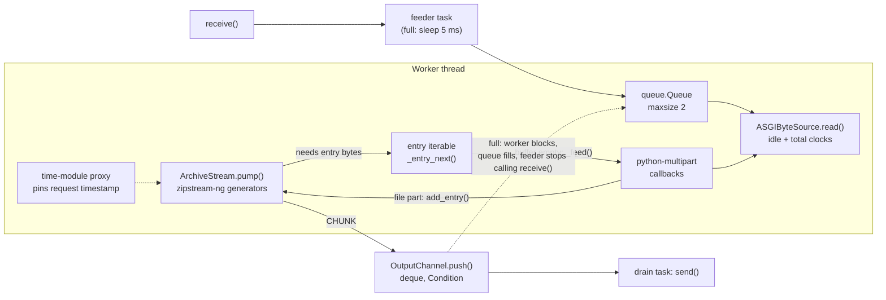

### CI and deployment
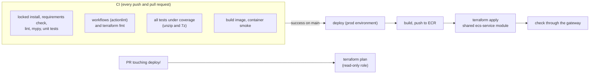

The CI was DSH's own originally; I reworked it by hand (setup-uv, locked installs, the requirements check, the static job, coverage). Image: single stage on a digest-pinned `python:3.12-slim`, installed from an exported `requirements-docker.txt`, non-root user `zipsvc`, plain `uvicorn` as the command. Same Fargate Spot sizing.

## Side by side
Where the work runs, which explains most of the differences, including the speed results:
```mermaid
flowchart TB
    subgraph CL["claude: event loop + to_thread per chunk"]
        direction LR
        c1["receive()"] --> c2["to_thread(feed)<br/>parse + zip, stdlib zipfile"] --> c3["OutputBuffer<br/>(asyncio, 16 MiB)"] --> c4["send()"]
    end
    subgraph GR["grok: parse on loop, one zip thread per request"]
        direction LR
        g1["receive()"] --> g2["hand-written<br/>multipart parser (loop)"] --> g3["queue, 4 slots<br/>full: sleep 100 ms"] --> g4["zip thread<br/>stdlib zipfile"] --> g5["OutputBuffer<br/>(thread-safe)"] --> g6["writer task<br/>send()"]
    end
    subgraph DS["dsh: feeder on loop, one parse+zip thread per request"]
        direction LR
        d1["feeder task<br/>receive()"] --> d2["queue, 2 slots<br/>full: sleep 5 ms"] --> d3["worker thread<br/>python-multipart + zipstream-ng"] --> d4["OutputChannel<br/>(deque, thread-safe)"] --> d5["drain task<br/>send()"]
    end
```

| | claude | grok | dsh |
|---|---|---|---|
| Multipart parsing | `python-multipart` (push), in a worker thread | hand-written (pull), on the event loop | `python-multipart`, in the worker thread |
| Threads | `to_thread` per chunk | one zip thread per request | one parse+zip thread per request |
| Hand-off to the thread | awaits each chunk | 4-slot queue, sleeps 100 ms when full | 2-slot queue, sleeps 5 ms when full |
| Zip writer | stdlib `zipfile` | stdlib `zipfile` | `zipstream-ng`, pull-driven |
| 100 MiB random data | 36.8 MiB/s | 3.0 MiB/s | about 37 MiB/s |
| 500 × 4 KiB files | 0.10 s | 37.7 s | 0.14 s |
| Test coverage | 97% | 89% | 93% |

## Deployment
Each service repository deploys only itself, onto a shared platform defined in this repository. The services' deploy workflows are the same template; what differs between them is CI and the image (see each section above).

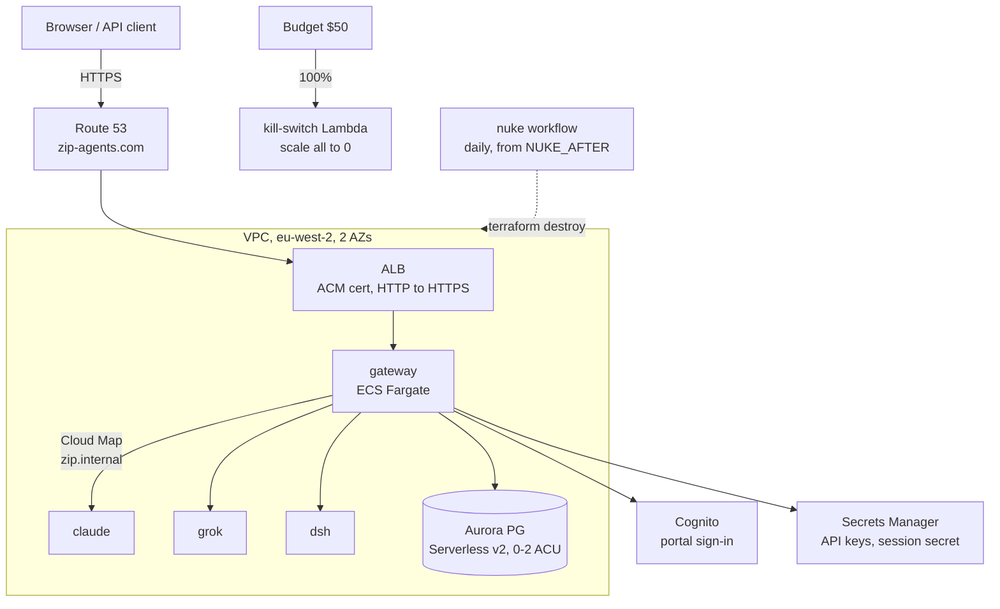

```mermaid
flowchart LR
    subgraph Each service repo
        PR["pull request"] --> CI["CI"]
        PR --> PLAN["terraform plan<br/>(plan role)"]
        MAIN["push to main"] --> CI2["CI"] -->|success| DEP["deploy (prod env, main only):<br/>push to ECR, terraform apply,<br/>smoke check"]
    end
    subgraph api-gateway
        GPR["pull request"] --> GPLAN["plan platform + gateway"]
        GMAIN["push to main"] --> GAPPLY["apply platform, then gateway"]
        MAN["manual"] --> INT["integration: all 3 locally"]
        MAN --> LIVE["live-smoke against prod"]
    end
    DEP & GAPPLY -->|"GitHub OIDC token<br/>(no stored keys)"| STS["AWS STS<br/>role per repo, least privilege"]
```

## With more time
* **A custom reasoning harness, then DSH again.** I'm currently writing my own harness, [xgenadam/multistep_reasoning](https://github.com/xgenadam/multistep_reasoning). It breaks a complex task down into sub-tasks and runs them in parallel, with more to come. Once it's done, I'd like to implement its methods as a custom reasoning harness for DSH and run DSH through this exercise again.
* **Rerun the other agents the same way.** I'd redo claude and grok with the plan-and-journal process I used for DSH, so the three are compared on the same process, and rerun DSH on the Flash Next optimisations from my runner work.
* **A more polished front end.** The portal is good enough for a PoC or MVP, but I'd add proper styling and improve the navigation.
* **Audit grok's and DSH's code properly.** I reviewed claude's code in depth, but only skimmed grok's and DSH's (apart from their deployment). The two biggest problems I know of, grok's throughput cap and DSH's false `zipfile` claim, both turned up from targeted reads, so a full audit would likely find more.
