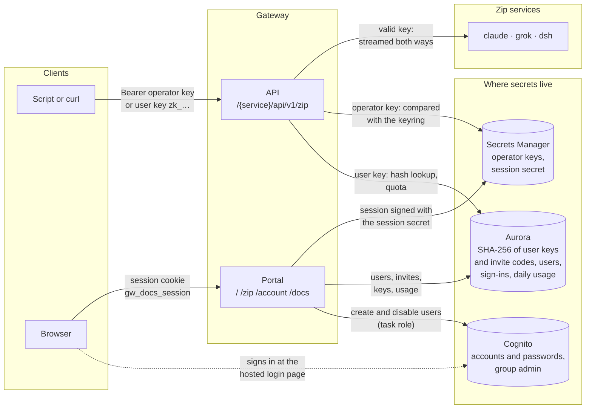
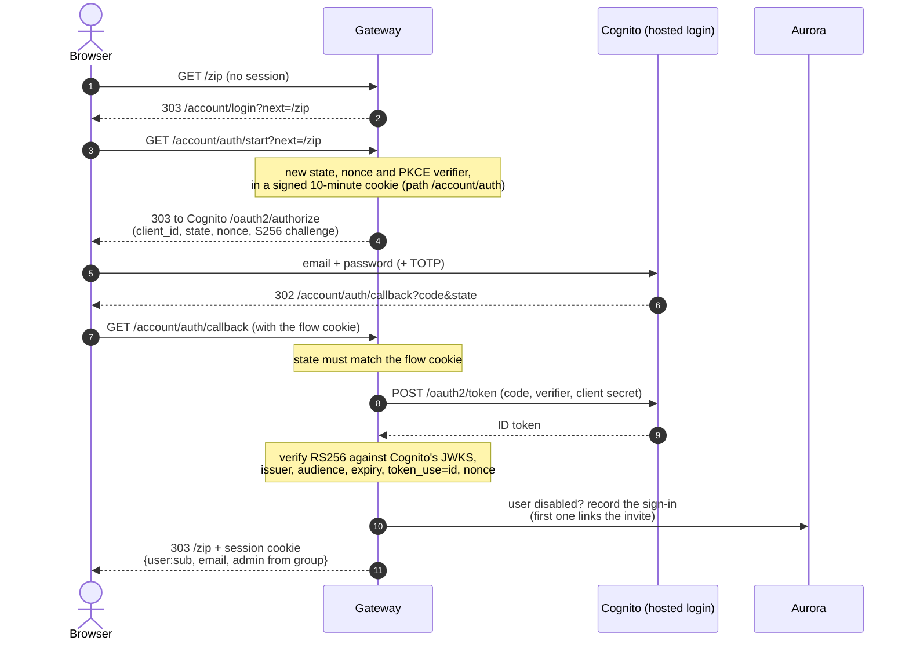
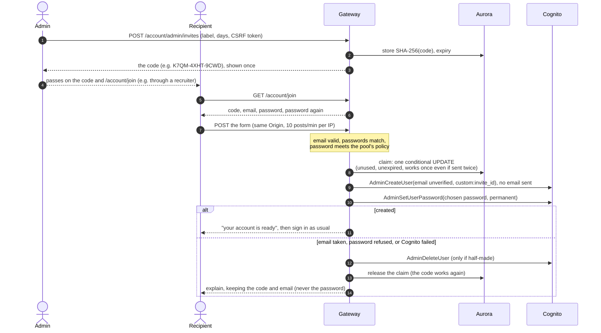
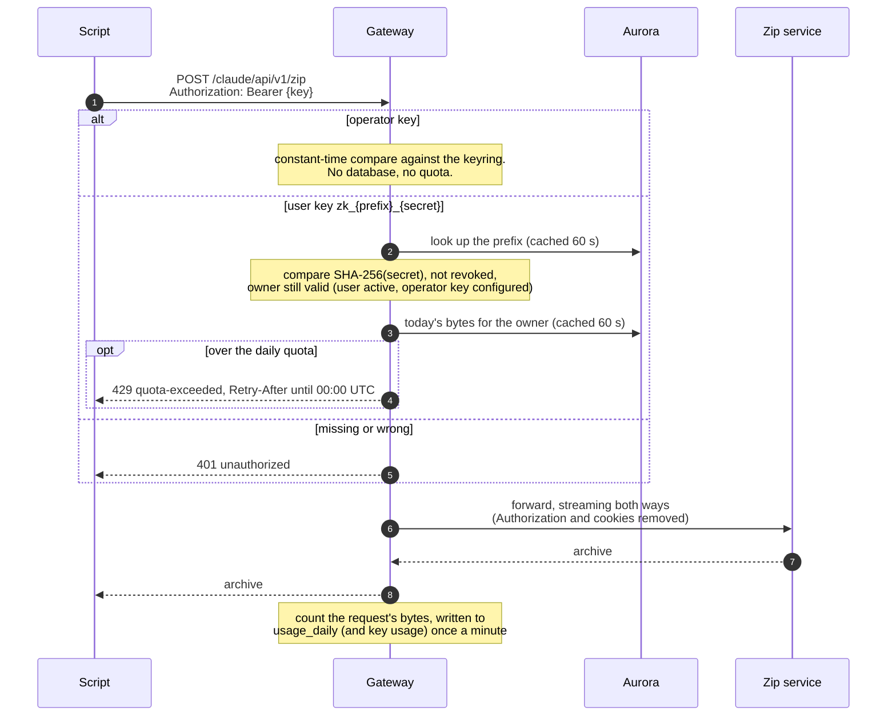

# Authentication and access

Two separate doors, with separate credentials:

- **The API** (`/<service>/api/v1/zip`) takes only `Authorization: Bearer <key>`. Cookies
  are never accepted there, so a signed-in browser can't be made to call the API from
  another site.
- **The portal** (`/` home, `/zip`, `/account/...` and the docs under `/docs/...`) takes
  only the gateway's own session cookie. Browsers get
  it by signing in with Cognito, or, locally only, with an operator API key (off in prod).

Code: `gateway/gateway/auth.py` (keys, sessions, CSRF), `gateway/gateway/accounts/`
(Cognito, invites, user keys, quota). Infrastructure: `terraform/modules/cognito-pool`.

**Locally there is no cloud:** `fake-cognito/` stands in for Cognito at the same paths
and in the same formats, so every diagram below holds with "Cognito" read as
fake-cognito (`http://localhost:9229`, outbox at `/outbox`). Real Cognito is checked on AWS.

## Credentials at a glance

| Credential | Who has it | Stored as | Gets you |
|---|---|---|---|
| Operator API key | automation (smoke tests), operators | plain, in Secrets Manager (`GATEWAY_API_KEYS`) | the API, no quota. Locally also portal sign-in without admin; in prod key sign-in is off (`GATEWAY_ALLOW_KEY_LOGIN=false`) |
| User API key `zk_<prefix>_<secret>` | a user, made on `/account/keys` (at most 5) | SHA-256 of the secret, in Aurora | the API, counted against the user's daily quota |
| Cognito password (+ optional TOTP) | a user, chosen when joining | in Cognito only | portal sign-in; admin pages if in group `admin` |
| Session cookie `gw_docs_session` | a signed-in browser | nowhere: HMAC-signed, HttpOnly, SameSite=Lax, path `/` (the API never reads it), 12 h | the portal; refused within a minute once the user is disabled or deleted (here or in Cognito), and at once after they sign out |
| Invite code `XXXX-XXXX-XXXX` | whoever an admin gives it to | SHA-256 of the code, in Aurora | one account, with an email and password they choose at `/account/join`, once, before it expires (1–30 days) |

## Signing in with Cognito

Authorization code with PKCE. The gateway verifies the ID token itself, then issues its
own session and keeps nothing from Cognito.

Signing out clears the cookie and also ends Cognito's own session (`/logout`), so the
next sign-in asks for the password again.

## Getting an account: invite codes

The admin doesn't know the recipient's email, so the recipient chooses it, along with
their password, on the site. Nothing is emailed.

## Calling the API

## The browser upload page

The page's uploads are two requests joined by the gateway (a download and an upload), and
both need the session cookie. Creating a job and uploading also need a same-origin
`Origin` and the session's CSRF token (an HMAC of the session cookie), so another site
can't start one. A job belongs to its user, and its ID is unguessable. The quota applies
here too.

## Checks that run on every portal request

- **Signature and expiry** of the session cookie. An operator session also needs its key
  to still be in the keyring.
- **Users who are disabled, deleted in Cognito, or signed out since** are refused. The
  check asks the database and Cognito when a request comes in, keeps the answer 60 s per
  user and task (so a busy user costs one lookup a minute, an idle one none), and is
  immediate on the task where the change was made.
- **Admin pages** need membership of the Cognito `admin` group, looked up the same way
  for admin sessions only: removing someone from the group applies within a minute;
  adding someone applies at their next sign-in. If Cognito can't be reached, admin rights
  wait until it answers.
- **Signing in and out** need a same-origin `Origin`, so another site can't sign a visitor
  in or out.
- **Every state-changing form** needs `Origin` equal to the gateway's public origin, plus
  the CSRF token.
- **Rate limits:** 10 posts a minute per IP on key sign-in (where it is on) and on
  joining with a code.
