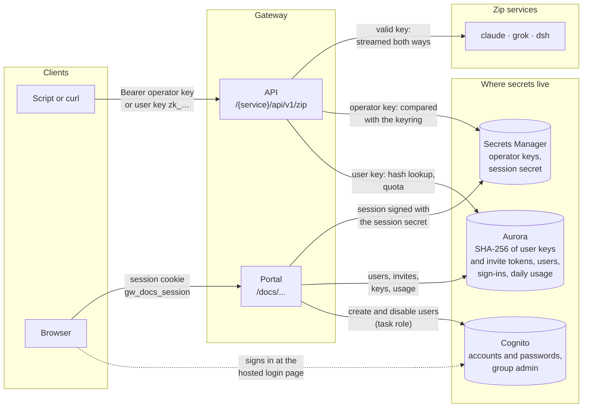
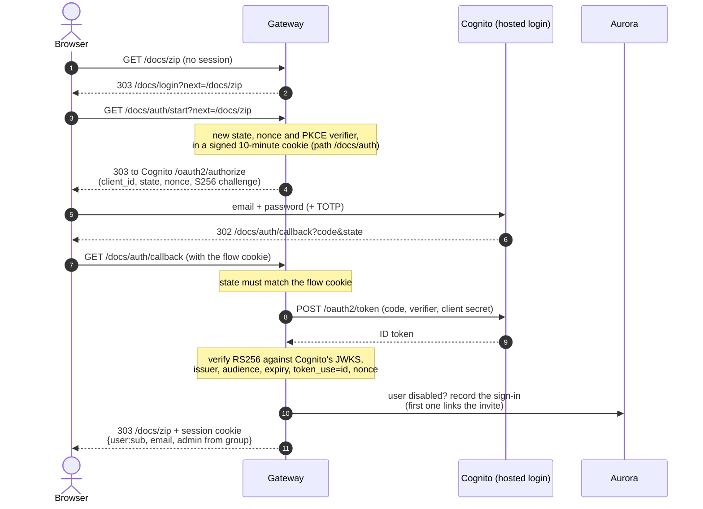
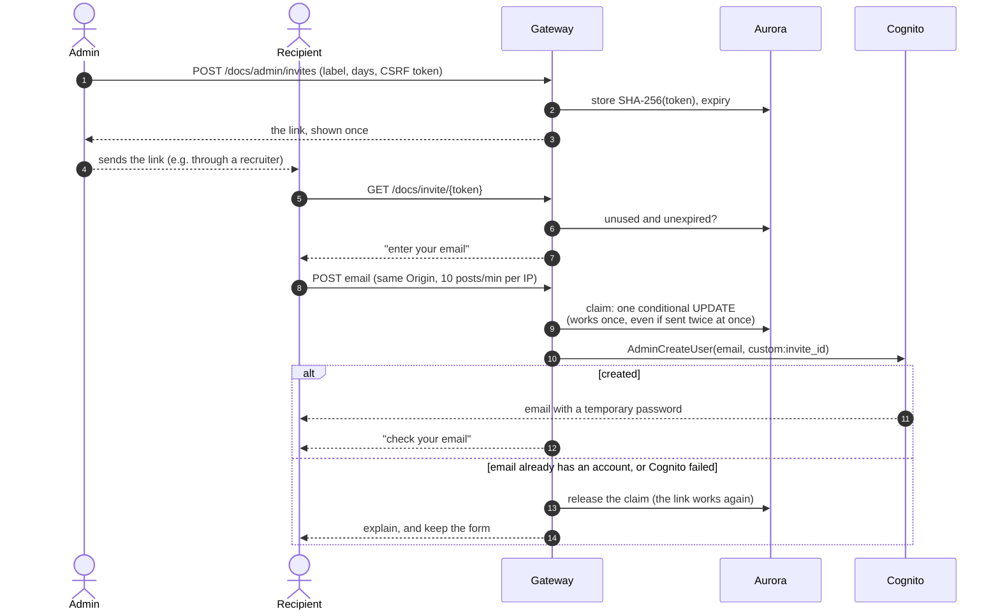
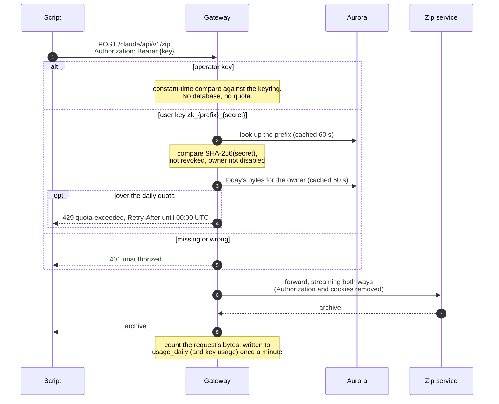

# Authentication and access

Two separate doors, with separate credentials:

- **The API** (`/<service>/api/v1/zip`) takes only `Authorization: Bearer <key>`. Cookies
  are never accepted there, so a signed-in browser can't be made to call the API from
  another site.
- **The portal** (`/docs/...`) takes only the gateway's own session cookie. Browsers get
  it by signing in with Cognito, or with an operator API key.

Code: `gateway/gateway/auth.py` (keys, sessions, CSRF), `gateway/gateway/accounts/`
(Cognito, invites, user keys, quota). Infrastructure: `terraform/modules/cognito-pool`.

## Credentials at a glance

| Credential | Who has it | Stored as | Gets you |
|---|---|---|---|
| Operator API key | automation (smoke tests), operators | plain, in Secrets Manager (`GATEWAY_API_KEYS`) | the API, no quota; portal sign-in without admin |
| User API key `zk_<prefix>_<secret>` | a user, made on `/docs/keys` (at most 5) | SHA-256 of the secret, in Aurora | the API, counted against the user's daily quota |
| Cognito password (+ optional TOTP) | a user, after an invite | in Cognito only | portal sign-in; admin pages if in group `admin` |
| Session cookie `gw_docs_session` | a signed-in browser | nowhere: HMAC-signed, HttpOnly, SameSite=Lax, path `/docs`, 12 h | the portal; disabled users are refused within a minute |
| Invite link `/docs/invite/<token>` | whoever an admin sends it to | SHA-256 of the token, in Aurora | one account, once, before it expires (1–30 days) |

## Signing in with Cognito

Authorization code with PKCE. The gateway verifies the ID token itself, then issues its
own session and keeps nothing from Cognito.

Signing out clears the cookie and also ends Cognito's own session (`/logout`), so the
next sign-in asks for the password again.

## Getting an account: invite links

## Calling the API

## The browser upload page

The page's uploads are two requests joined by the gateway (a download and an upload), and
both need the session cookie. Creating a job and uploading also need a same-origin
`Origin` and the session's CSRF token (an HMAC of the session cookie), so another site
can't start one. A job belongs to its user, and its ID is unguessable. The quota applies
here too.

## Checks that run on every portal request

- **Signature and expiry** of the session cookie. An operator session also needs its key
  to still be in the keyring.
- **Disabled users** are refused. The check is cached 60 s per task, and is immediate on
  the task where the admin disabled them.
- **Admin pages** need the `admin` flag, taken from the Cognito group at sign-in.
- **Every state-changing form** needs `Origin` equal to the gateway's public origin, plus
  the CSRF token.
- **Rate limits:** 10 posts a minute per IP on key sign-in and invite redemption.
